# LNS + CID Web Browser — Architecture & Framing

A censorship-resistant, privacy-first web layer on the Logos stack:
**`lns://<name>` URLs on LEZ** + **content-addressed sites in Logos Storage CIDs** + **offline, zero-leak rendering in Basecamp**.

---

## 1. Core Idea

| Web2 | Logos Web (`lns-browser`) |
|---|---|
| DNS + Registrars + CA certs | **LNS on LEZ 0.4** (Argon2id-derived PDA, AES-GCM sealed record, self-custodied) |
| Origin servers / CDNs | **Logos Storage CIDs** (single-file HTML or v1 multi-file JSON site manifest) |
| Trust TLS + server | **On-chain SHA-256 commitment** (`cid` + `cid.sha256` verified locally before rendering) |
| Chrome/Safari + extensions + trackers | **Basecamp-native viewer** (no extensions, hard network kill-switch, JS off by default) |

---

## 2. End-to-End Flow

```mermaid
flowchart LR
    U["User types lns://jef/about.html"] --> P["URL Parser"]
    P --> LNS["LNS Resolver (Argon2id + AES-GCM)"]
    LNS -->|"getAccountView (LEZ 0.4)"| LEZ["LEZ Node / Sequencer"]
    LEZ -->|"cid + cid.sha256 + cid.type"| V1["Verify Root CID Hash"]
    V1 -->|"GET /api/storage/v1/data/<cid>"| ST["Local Logos Storage Node"]
    ST -->|"bytes"| V2["SHA-256 + Size Check"]
    V2 -->|"v1 manifest or single HTML"| R["Isolated Renderer (Zero External Network)"]
```



### On-Chain Record Schema (Uses Existing LNS v5/v6 — Zero New Chain Deploy)
Stored inside the name's encrypted LNS profile text entries:

| Key | Value | Purpose |
|---|---|---|
| `cid` | `zDv…` | Root Logos Storage CID (HTML file or v1 site manifest) |
| `cid.sha256` | 64-char hex | Mandatory SHA-256 integrity commitment for the root CID bytes |
| `cid.type` | `manifest` \| `single` | Hint for root payload format (also auto-detected) |

### Site Manifest Schema (`kind: "lns-site-manifest"`, `version: 1`)
```json
{
  "kind": "lns-site-manifest",
  "version": 1,
  "title": "Demo Site",
  "index": "/index.html",
  "files": {
    "/index.html": { "cid": "zDv...", "sha256": "...", "size": 612, "contentType": "text/html; charset=utf-8" },
    "/style.css":  { "cid": "zDv...", "sha256": "...", "size": 845, "contentType": "text/css; charset=utf-8" },
    "/about.html": { "cid": "zDv...", "sha256": "...", "size": 540, "contentType": "text/html; charset=utf-8" }
  }
}
```
Every asset in a multi-file site is individually content-addressed and hash-verified before being served.

---

## 3. Threat Model & Privacy Boundaries

### What Is Protected Today
- **On-chain name privacy:** Plaintext names never hit the chain; records are Argon2id-derived and AES-GCM encrypted (256-byte padded). Sites cannot be scraped or enumerated from the ledger.
- **Publisher privacy:** Owner tags are salted per name; private LEZ transactions hide who registered or updated a site.
- **Content integrity:** Tampered bytes from a Storage node or peer fail SHA-256 verification and are discarded unparsed (`HTTP 502`).
- **Page isolation:** Rendered pages cannot make external `fetch`/XHR/WebSocket calls (`connect-src 'none'`), send referrers (`no-referrer`), or access the browser shell (`<iframe sandbox>`).

### Known Remaining Leaks & How Each Phase Closes Them

| Leak Vector | Phase 1: Localhost Browser (`127.0.0.1`) | Phase 2: In-Basecamp Browser | Phase 3: Full-Stack Privacy |
|---|---|---|---|
| **Browser extensions** | Vulnerable (host browser extensions bypass CSP) | **Closed** (no extensions in Basecamp) | Closed |
| **Localhost port probing** | Mitigated (Host check + ephemeral port/token) | **Closed** (in-process scheme handler, no TCP port) | Closed |
| **WebRTC / DNS / telemetry** | Partially mitigated (depends on host browser) | **Closed** (C++ `UrlRequestInterceptor` drops all non-`lns://` traffic) | Closed |
| **Hostile JS exploits** | Host browser sandbox | **Mitigated** (JS OFF by default; per-name opt-in; native QML Markdown/static fallback) | Hardened |
| **RPC lookup IP correlation** | Remote sequencer sees IP + queried PDA | Remote sequencer unless local LEZ node is used | **Closed** (local LEZ node or mixnet/Tor RPC) |
| **Storage P2P CID request IP** | Libp2p peers see Storage node IP | Libp2p peers see Storage node IP | **Closed** (mixnet/Tor transport or private encrypted CIDs) |

---

## 4. Phased Roadmap

- **Phase 1 — Working Prototype & Publisher (Done in `lns-browser/`)**
  - Loopback browser + LNS v5/v6 resolver + Logos Storage client + v1 multi-file manifest publisher + CLI + Basecamp `ui_qml` module (`lns_browser`) + end-to-end tests.
  - *Next quick hardening:* ephemeral port + session capability token + **JS OFF by default** toggle in the browser bar.
- **Phase 2 — Native In-Basecamp Browser**
  - Rust/C++ core module (`lns_browser_core`) calling `names` + `logos-storage-module` directly in-process (zero `127.0.0.1` port).
  - Native QML renderer for static/Markdown/profile pages (works on macOS, Linux, Windows with zero Chromium bloat).
  - Optional WebView / `QtWebEngine` backend with custom `lns://` scheme handler, C++ hard network kill-switch, and JS-off-by-default per-name toggle.
- **Phase 3 — Private Sites & Local-Node Mode**
  - Default to user's local LEZ node inside Basecamp so no remote RPC sees name lookups.
  - Optional encrypted CID sites (shared secret in URL fragment `lns://name#<key>` — never leaves the client).
  - In-Basecamp one-click site publisher (folder picker → `logos-storage-module` upload → `names.set_profile` on-chain commit).
